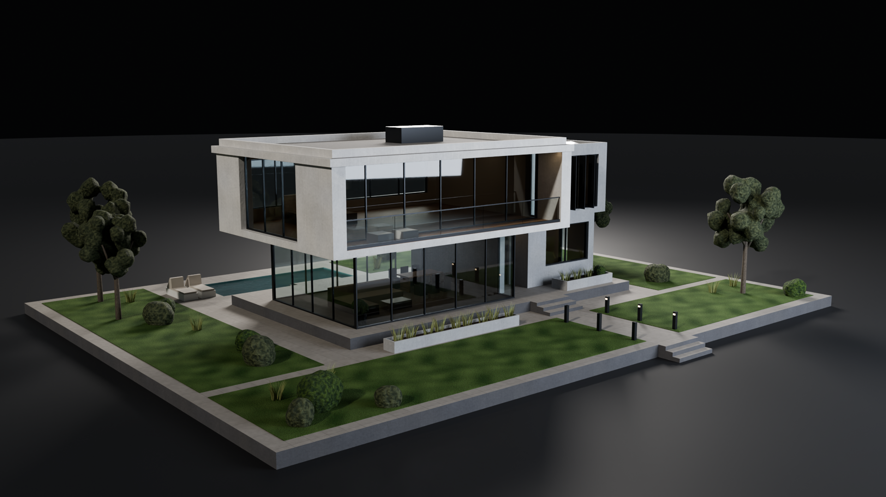
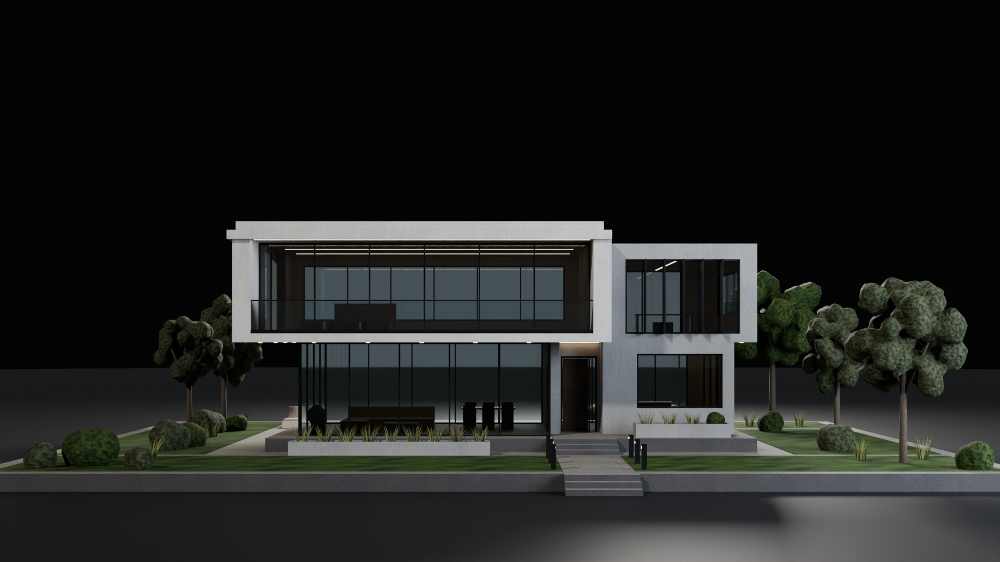
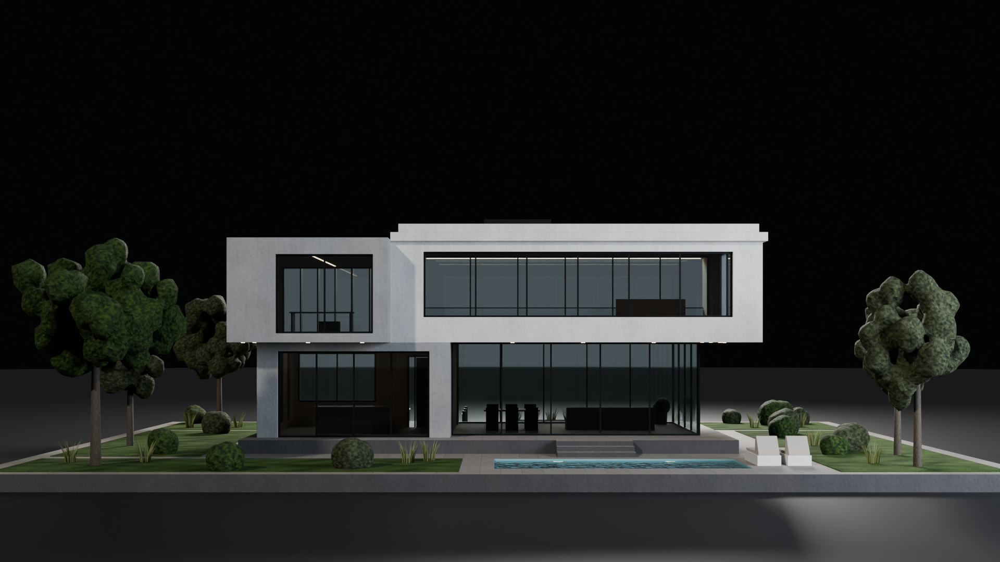
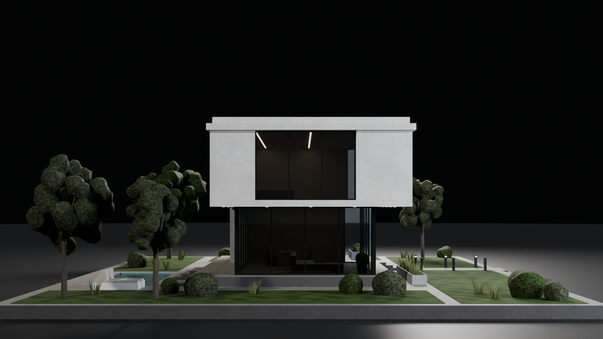

# SmartEstate AI: modern villa (3D showcase asset)

This is an original, procedurally built two-storey luxury villa for the 360° property showcase on the marketing website.

> **Fictional demo asset.** The villa is not a real property, address or listing, and it is not part of the NOVA Residences demo data. Treat it as an illustrative model only.



| Front | Rear | Side (west) |
|---|---|---|
|  |  |  |

## Files

| File | Purpose |
|---|---|
| `create_model.py` | Builds everything from scratch with `bpy`: geometry, procedural textures, materials, studio scene, GLB export, renders and the GLB validation mode |
| `smartestate_modern_villa.glb` | Web asset for Three.js / React Three Fiber (about 3.7 MB) |
| `smartestate_modern_villa.blend` | Source scene with the model, studio, light rig and cameras; textures are packed |
| `hero_render.png`, `front_render.png`, `rear_render.png`, `side_render.png` | 1920×1080 Cycles presentation renders |

No external models or textures are used. Every texture is generated in `create_model.py` with numpy (tileable FFT noise), then packed into the `.blend` and embedded in the GLB.

## Rebuilding

The script needs Blender 4.2 or later. It was built and verified with **Blender 5.3.0** (glTF I/O 5.3.43).

```bash
blender --background --factory-startup --python create_model.py
```

Useful options go after `--`, for example `-- --samples 64 --res 50`, `-- --skip-render` or `-- --out <dir>`.

To re-import the GLB into a clean scene and print or write the validation report:

```bash
blender --background --factory-startup --python create_model.py -- --validate
```

With the Microsoft Store build of Blender, run `blender-launcher.exe` instead of `blender`. It does not forward stdout, so pass `--log <file>` to capture the output.

A full build takes about 1.5 minutes on an RTX 3050 with OptiX: about 6 s for geometry and export, then about 20 s per 1080p render.

## Model summary

**Scale and orientation.** The model uses metres at real-world scale. The platform is 30.0 × 24.1 m and the top of the roof enclosure is 8.55 m. The ground floor finished level is +0.95 m and the first floor is +4.45 m.

**Pivot.** The root node `SmartEstate_Modern_Villa` sits at the centre of the building footprint, at ground level (the underside of the landscaped platform is y = 0). It has an identity transform, and so does every child, because all transforms are applied.

**Axes in Three.js.** Y is up. The front (entrance) facade faces **+Z**, and the west cantilever points to **−X**.

**Triangles.** About 51k (50,956), across 71 meshes and 25 PBR materials.

**GLB contents.** Meshes and materials only: no cameras, lights, animations or Draco compression. The extensions used are `KHR_materials_transmission`, `_ior`, `_specular`, `_emissive_strength` and `_clearcoat`, all of which three.js r181 supports natively. Textures are embedded as JPEG: 16 images at 512 px and 1024 px.

### Architecture

- **Upper volume (white concrete).** It cantilevers 2 m to the west and 1.5 m to the south over a glass living pavilion. A recessed south balcony has a full-height glazed wall, a frameless glass balustrade and an LED soffit line. The roof is layered: a projecting roof plate, a set-back parapet, a gravel roof and a plant enclosure.
- **Offset volume (light-grey concrete).** It has a picture window with vertical aluminium fins, an east ribbon window, a north window and a solar array on a lower parapeted roof.
- **Ground-floor block.** It contains the recessed entrance with a smoked-oak pivot door, an aluminium pull handle and a sidelight, plus the kitchen window, east slot windows and a north garden sliding wall.
- **Landscaping.** The platform has three-riser entrance steps, site steps, garden steps, the terrace podium, lawns, two concrete planters, a pool with water and pool lights, path bollards, loungers, five trees, 12 garden shrubs, a planter shrub and ornamental grasses.
- **Interior.** Simple low-poly furniture is readable through the glass: sofa, dining set, kitchen island, bed and desk. Warm emissive ceiling lines light the inside. The interior is not navigable and isn't meant to be.
- **Lighting.** All lighting is emissive geometry: soffit downlights, the balcony LED line, a door wall-washer, bollards and pool lights. It glows in the website with no punctual lights.

### Scene organisation (`.blend`)

```
SmartEstate_Villa
├─ 01_Structure            Villa_Structure_Concrete (single clean boolean-unioned shell)
├─ 02_Glazing              Frame_* / Glass_* per facade element
├─ 03_Architectural_Details  fins, balcony railing, entrance door, roof plant + solar
├─ 04_Interior             furniture, planter pot
├─ 05_Landscape            Site_Platform_Terraces_Pool, planters, pool water, loungers
├─ 06_Vegetation           Tree_*_Trunk / Tree_*_Canopy, Shrub_*, ornamental grasses
└─ 07_Lighting_Fixtures    exterior / interior emissive fixtures, path bollards
Presentation_Studio        charcoal studio floor, Key_Sun / Fill_Area / Rim_Area on Light_Rig,
                           CAM_Hero_ThreeQuarter_Persp, CAM_Front/Rear/Side_West_Persp,
                           CAM_ThreeQuarter_Ortho, CAM_Front_Ortho   (not exported)
```

The materials (`M_*`) are shared and reused across objects. For example, one concrete normal map serves all three concrete tones, and one glass and one aluminium material serve every opening. The concrete is matte (roughness 0.82–0.86, low specular). Its subtle variation comes from the albedo and normal textures, not from gloss.

### Validation (last run)

| Check | Result |
|---|---|
| Inconsistent normals, degenerate faces, loose geometry (all 71 meshes) | 0 / 0 / 0 |
| Closed meshes have positive signed volume | Yes |
| Backface render check (backfaces drawn red) from 4 corners, the roof and close-ups | No flipped faces visible |
| Modifiers or non-identity transforms on exported objects | None |
| Unused or empty material slots, orphan data | None (purged) |
| GLB re-imported into a clean factory scene | 71 meshes, 50,956 triangles |
| Materials and textures after re-import | All 25 materials present; 16 images embedded and relinked |
| Bounding box after re-import (Y-up) | x −15.03…14.98, y 0…8.55, z −11.67…12.43 |
| Building footprint centre | (0, 0), at ground level |
| Cameras or lights in the GLB | None |
| File size | 3.68 MB (limit 15 MB) |

Hidden contact faces were removed during the build: the undersides of walls, planters and steps that sit on other geometry, and the platform's base face. The concrete volumes are one exact-boolean union, so there are no overlapping shells. Bevels (12 mm, angle-limited, with hardened normals) are applied only to the concrete structure and planters.

## Website integration (React Three Fiber + Drei)

This asset is not wired into the app yet. To integrate it, copy the GLB to `apps/marketing/public/models/smartestate_modern_villa.glb`. The marketing app already has `three@0.181`; it will also need `@react-three/fiber@9` and `@react-three/drei@10`, which support React 19.

The building is static, and the camera orbits around it. Don't add first-person or interior navigation.

```tsx
import { Suspense, useRef } from "react";
import { Canvas } from "@react-three/fiber";
import { OrbitControls, useGLTF, ContactShadows, Environment } from "@react-three/drei";
import type { OrbitControls as OrbitControlsImpl } from "three-stdlib";
import * as THREE from "three";

const MODEL_URL = "/models/smartestate_modern_villa.glb";
const HOME_POSITION = new THREE.Vector3(-27, 10.5, 33); // matches the hero render
const TARGET = new THREE.Vector3(0, 3.2, 0);            // building centre, mid-height

function Villa() {
  const { scene } = useGLTF(MODEL_URL);
  // the glTF is already centred at the footprint with y = 0 at ground level
  return <primitive object={scene} />;
}
useGLTF.preload(MODEL_URL);

export function VillaShowcase() {
  const controls = useRef<OrbitControlsImpl>(null);

  const resetCamera = () => {
    const c = controls.current;
    if (!c) return;
    c.object.position.copy(HOME_POSITION);
    c.target.copy(TARGET);
    c.update();
  };

  return (
    <>
      <Canvas
        camera={{ position: HOME_POSITION.toArray(), fov: 32, near: 0.5, far: 400 }}
        gl={{ antialias: true, toneMapping: THREE.AgXToneMapping }}
        dpr={[1, 2]}
      >
        <color attach="background" args={["#141518"]} />
        <hemisphereLight args={["#d9e2ff", "#202020", 0.6]} />
        <directionalLight position={[-22, 26, 26]} intensity={2.2} />
        <Environment preset="city" environmentIntensity={0.35} />
        <Suspense fallback={null}>
          <Villa />
        </Suspense>
        <ContactShadows position={[0, 0.002, 0]} scale={44} far={10} blur={2.4} opacity={0.6} />
        <OrbitControls
          ref={controls}
          target={TARGET.toArray()}
          enableDamping
          dampingFactor={0.08}
          rotateSpeed={0.6}
          zoomSpeed={0.8}
          enablePan={false}
          minDistance={16}
          maxDistance={65}
          minPolarAngle={0.15 * Math.PI}          // no straight-down view
          maxPolarAngle={Math.PI / 2 - 0.1}       // stays above the ground plane
          makeDefault
        />
      </Canvas>
      <button type="button" onClick={resetCamera}>Reset view</button>
    </>
  );
}
```

Notes on these settings:

- **Damping.** With `enableDamping`, R3F's `OrbitControls` calls `update()` every frame, so the camera eases smoothly. Keep `dampingFactor` between 0.05 and 0.1.
- **Polar limits.** `maxPolarAngle = π/2 − 0.1` keeps the camera about 6° above the horizon, so it never dips below the platform or ground. `minPolarAngle` stops a straight top-down view, though the gravel roofs and solar array are still visible.
- **Zoom limits.** A `minDistance` of 16 m keeps the camera outside the 30 m platform footprint. A `maxDistance` of 65 m keeps the villa filling the viewport. Panning is disabled so the target stays on the building.
- **Target.** `(0, 3.2, 0)` is the centre of the building at mid-height. The GLB pivot is the footprint centre at ground level, so no extra offset is needed.
- **Reset.** Copy the stored home position and target back, then call `controls.update()`. For an animated reset, lerp `camera.position` and `controls.target` towards the home values in `useFrame` over about 0.6 s, then call `update()`. Alternatively, use drei's `CameraControls`, which has `setLookAt(..., true)` for a built-in smooth transition.
- **Glass.** It uses `KHR_materials_transmission`, so three.js renders it as a physical transmissive material that shows the interior. On low-end mobile devices you can trade realism for speed by traversing the scene and replacing the glass material, for example with `transmission = 0; transparent = true; opacity = 0.3; roughness = 0.05`.
- **Ambient occlusion and shadows.** The GLB carries no baked AO maps. The renders get AO and soft shadows from Cycles. On the web, use `ContactShadows` for grounding, plus optional screen-space AO (for example `N8AO` from `@react-three/postprocessing`). If you prefer real-time shadows, enable `castShadow` and `receiveShadow` on the meshes and on the directional light.
- **Lighting fixtures.** These are emissive materials (`KHR_materials_emissive_strength`). They look best with a `Bloom` pass (`luminanceThreshold` about 1, low intensity). They need no additional lights.
