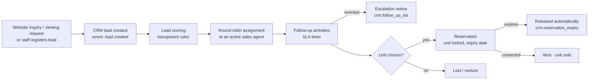
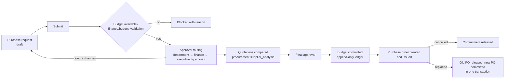
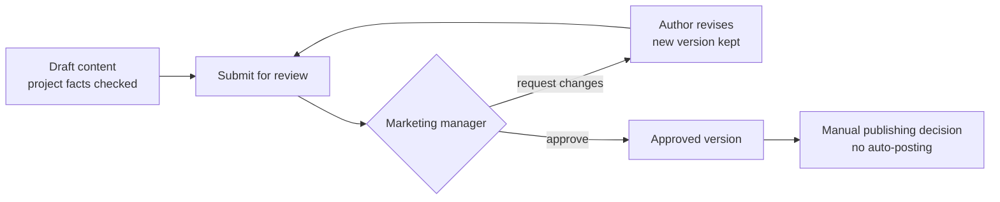
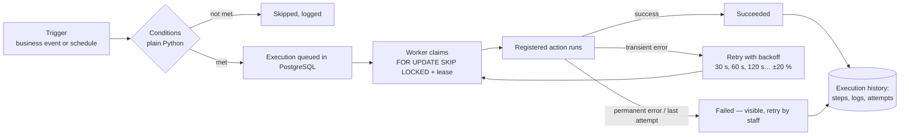

# Business workflows

Four separate workflows, each implemented in the API (diagrams in Mermaid — they render on GitHub and in most
Markdown viewers). Automated steps run as registered workflows in the automation engine (`app/automation`).

## 1. Customer and sales

Stages: new → contacted → qualified → viewing → negotiation → won / lost. Only one active reservation per unit
(database constraint); a reservation locks the unit until it expires or is converted.

## 2. Procurement

Requesters never approve their own documents; amounts are exact decimals; every step is audited.

## 3. Marketing content

Authors and editors of an item are excluded from approving it; versions and the review history are kept.
AI drafting exists behind `AI_MARKETING_STUDIO_ENABLED` and is **switched off**.

## 4. Automation engine

Registered workflows: `procurement.purchase_request_approval`, `procurement.supplier_analysis`,
`finance.budget_validation`, `crm.lead_registration`, `crm.follow_up_sla`, `crm.reservation_expiry`,
`marketing.content_review`.
